```console
cnasir@dallas:~$ open --projects
```

- [**prospecting-agent**](https://github.com/C-NASIR/sales_research_agent): researches companies, scores them with reasons and drafts outreach, with a person deciding what goes out · [write-up](https://cnasir.dev/work/prospecting-agent)
- [**policyos**](https://github.com/C-NASIR/warp_policy_assignment_system): turns workforce policies into explainable, auditable decisions, with an MCP server so AI clients can ask why · [write-up](https://cnasir.dev/work/policyos)
- [**agent-harness-from-scratch**](https://github.com/C-NASIR/agent-harness-from-scratch): an AI agent built by hand in Python and SQLite, no frameworks · [videos](https://www.youtube.com/playlist?list=PLRDzL3zlOIDE) · [write-up](https://cnasir.dev/work/agent-harness)
- [**modern_reverse_proxy**](https://github.com/C-NASIR/modern_reverse_proxy): a Go reverse proxy with atomic config swaps, canary routing and circuit breakers · [write-up](https://cnasir.dev/work/reverse-proxy)
- [**distributed-rate-limiter**](https://github.com/C-NASIR/distributed-rate-limiter): rate limiting as a service over HTTP and gRPC · [write-up](https://cnasir.dev/work/rate-limiter)

```console
cnasir@dallas:~$ open --teaching
```

- [Build an AI Harness from Scratch, by Hand](https://www.youtube.com/playlist?list=PLRDzL3zlOIDE) (video series)
- [React, from First Principles](https://cnasir.dev/writing/react) and [Redux, from First Principles](https://cnasir.dev/writing/redux) (written courses)
- [All videos on YouTube](https://www.youtube.com/@cnasir)

```console
cnasir@dallas:~$ contact
```

[cnasir.dev](https://cnasir.dev) · [YouTube](https://www.youtube.com/@cnasir) · [LinkedIn](https://www.linkedin.com/in/cnasir2) · [X](https://x.com/CNASIR2_0) · [email](mailto:cnasir22.0@gmail.com)
